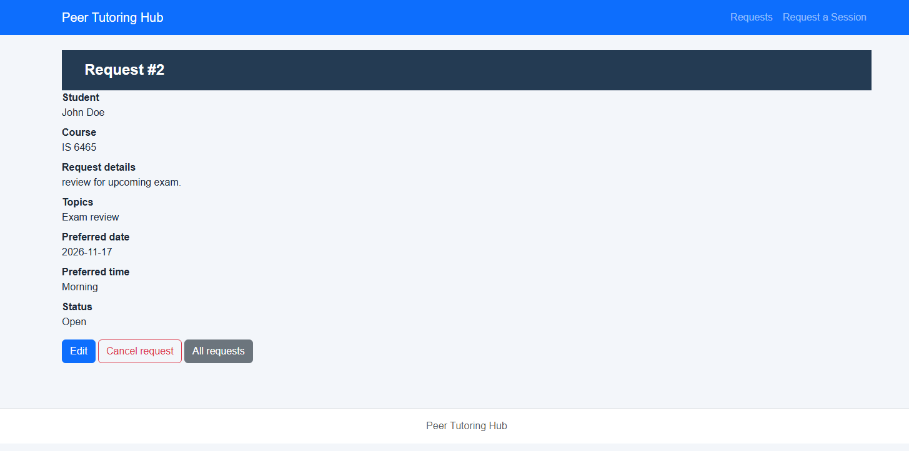

1. sqlite prompt command: .tables
    output: students           tutoring_requests

2. URL: https://bookish-xylophone-59rrrxw7r4cvg6q-8000.app.github.dev/php/request-form.php
- the request was successfully saved and displayed.
    

3. | Test | What I Did | Expected Result | Actual Result | Pass or Fail |
|---|---|---|---|---|
| Submit a valid request | Filled out the request form with test data (John Doe, 123@test.edu, IS 6465, review for upcoming exam., exam review, 2026-11-17) and submitted it. | A new tutoring request is created with status Open. | The request was saved and the detail page showed it with status Open. | Pass |
| View all requests | Opened the request list page. | The new request appears in the request list. | The new request showed up in the list with the right course, topic, and date. | Pass |
| Filter requests | Filtered the list by course (IS 6465), then by status (Open). | Filtering by course or status shows matching requests. | Only requests matching the selected course or status were shown. | Pass |
| Edit an Open request | Opened the Open request, changed the topic and preferred time, and saved. | The revised values are displayed. | The detail page showed the new topic and time. | Pass |
| Cancel an Open request | Clicked cancel on the Open request. | The request status changes to Cancelled. | The status changed to Cancelled. | Pass |
| Try to edit or cancel a cancelled request | Went back to the cancelled request and tried to edit it and cancel it again. | The application does not allow the change. | The edit and cancel options were blocked and the request stayed Cancelled. | Pass |

4. 
    1. php/request-form.php displays the form.
    2. php/process-request.php receives the submitted form data.
    3. config/db.php opens the PDO connection to SQLite, in the openDatabase() function. It also turns on foreign keys.
    4. services/requestService.php coordinates validation and the transaction.
    5. repositories/studentPDO.php and repositories/requestPDO.php contain the SQL statements. database/setup-database.sql has the CREATE TABLE statements.
    6. The students table stores student information.
    7. The tutoring_requests table stores tutoring requests.
    8. Each request stores a student_id that points to the student.

5. 
 ran integration tests using the command " php tests/integration-tests.php "
output: 
PASS UC01 create and Open
PASS Lab 4 checkbox values preserved
PASS Duplicate email reuses student
PASS UC02 course and status filter
PASS Invalid reason rejected
PASS Invalid submission writes nothing
PASS Edit Open request
PASS Updated reason persisted
PASS Cancel Open request
PASS Cancelled row retained
PASS Second cancellation rejected
PASS Unrelated request unchanged
PASS FK enforced
PASS UC02 empty filter result
All integration checks passed

- this required me to clear entries from the db before all integration tests would pass. Three tests failed before clearing db entries.

6. 
prompt 1: Explain how a tutoring request moves from php/request-form.php through PHP, PDO, and SQLite in this project. Identify the responsibility of each file.
response: "Here’s how a request moves through the app, step by step.

php/request-form.php shows the form. It pulls in includes/header.php and includes/nav.php for the layout, plus includes/footer.php at the end. The form sends a POST to process-request.php with the student’s name, email, course, preferred date, a reason, topic checkboxes, and a preferred time. It also sends a hidden field, form_name=tutoring_request. This page has no PHP logic or SQL of its own; it’s just HTML.
php/process-request.php receives the submission. It rejects anything that isn’t a POST (405) and anything missing the hidden form_name value (400). It then opens a database connection with openDatabase() and passes $_POST to submitRequest(). If that works, it redirects to request-details.php?request_id=... with a 303. If validation fails, it shows the error messages with a 422. Any other error is logged and the user gets a generic 500 message, so the database details aren’t shown.
config/db.php opens the PDO connection to database/tutoring.db. It sets PDO to throw exceptions on errors, return rows as associative arrays, and turn on PRAGMA foreign_keys = ON. SQLite needs that pragma on every connection.
services/requestService.php holds the business logic. validateSubmission() trims the input and checks it. Name and email are required, and the email has to be valid. The course has to be one of the three allowed values, and the date has to be a real date that’s today or later. It uses includes/validation.php for the time, topics, and reason checks (10–500 characters). It also packs the reason and topics into a JSON string for the single topic column. submitRequest() then starts a transaction, makes sure the student exists, looks up their ID, inserts the request, and commits. If anything fails, it rolls everything back.
includes/validation.php has the Lab 4 validation functions: validatePreferredTime(), validateTopics(), and validateReason(). They only allow the exact values the form offers.
repositories/studentPDO.php has the student SQL. insertStudentIfAbsent() runs INSERT OR IGNORE, so a returning email doesn’t create a duplicate. findStudentByEmail() gets the student_id.
repositories/requestPDO.php has the request SQL. insertTutoringRequest() inserts the row and returns the new ID from lastInsertId(). The same file also has the find, list/filter, update, and cancel queries. Every query is a prepared statement with ? placeholders.
The SQLite database (database/tutoring.db) stores the data in two tables, created by database/setup-database.sql. students has a UNIQUE email. tutoring_requests has a student_id foreign key and a CHECK limiting status to Open, Cancelled, Assigned, or Completed. New requests default to Open.
php/request-details.php closes the loop. It reads the ID from the URL, calls findRequest(), which joins the request to its student, and decodes the JSON topic. It then shows everything with escapeHtml() to prevent XSS.

So the full path is: form → process-request.php → requestService.php (validation + transaction) → studentPDO.php and requestPDO.php → SQLite → redirect to request-details.php."

- the response states that the request-form.php page "sends a POST to process-request.php with the student’s name, email, course, preferred date, a reason, topic checkboxes, and a preferred time." This can be verified in the request-form.php code in these lines: 
<form class="tutoring-request-form" action="process-request.php" method="post">
   <input type="hidden" name="form_name" value="tutoring_request">
the inclusion of method="post" and action="process-request.php" verifies the accuracy of the AI's statement here.

prompt 2: Trace the requirement “a student can submit a tutoring request” through the PHP files, service, repositories, SQLite tables, and integration tests in this project.
| Requirement | Application Page | Service or Validation | Repository or SQL | Database Table | Test Evidence |
|---|---|---|---|---|---|
| Student submits a tutoring request | `php/request-form.php` shows the form; `php/process-request.php` receives the POST; `php/request-details.php` shows the saved request | `services/requestService.php`: `validateSubmission()` checks the input, `submitRequest()` runs the transaction; `includes/validation.php` checks time, topics, and reason | `studentPDO.php`: `INSERT OR IGNORE INTO students`, then `SELECT student_id ... WHERE student_email = ?`; `requestPDO.php`: `INSERT INTO tutoring_requests (...) VALUES (?,?,?,?,?)` | `students` and `tutoring_requests`, linked by the `student_id` foreign key | `tests/integration-tests.php`: "UC01 create and Open", "Duplicate email reuses student", "Invalid reason rejected", "Invalid submission writes nothing", "FK enforced" |

prompt 3: Suggest one useful test case for the Peer Tutoring Hub application. The test must relate to request creation, filtering, editing, cancellation, validation, or database integrity.

response: "Here’s my suggestion: test that a cancelled request can’t be edited.

Once a request is cancelled, trying to edit it should fail and the saved data should stay the same. This is a business rule the app depends on. The edit page hides the form for non-Open requests, but someone could still send a POST straight to update-request.php. So the real protection has to come from the WHERE request_id = ? AND status = 'Open' condition in updateOpenRequest()."

- this test is not already covered in integration-tests.php. A test is done to attempt cancelling a request a second time but not attempting to edit a cancelled request. 
- to test this manually, I would cancel an open test request, then go to request.php and view the cancelled request and attempt to edit it. In practice this would not be allowed by the front end page as a cancelled request does not show an option to edit. You can also directly type the request id of a cancelled request into the edit-request page url, this method displays a message stating: "Only Open requests may be edited".
- This test is appropriate for this application because it is an important function that cancelled requests cannot be edited.

Using an AI tool assisted me in understanding the application because it was able to explain the movement of requests from the application layer to the data layer in detail. This explaination helped me understand exactly how a requests moves through different parts of the application and what files handle which functions. Another thing the AI tool helped me with in this lab was locating issues much faster than i would have been able to myself. For example, my first attempt at running the integration test resulted in three failed tests, and one simple prompt to the AI tool asking what was going wrong immediately identified that the sample data in the database was causing the issue and that clearing the database before running the test would fix the issue. after implementing this change the integration tests all passed as expected.

7. 
The JOIN statement in this query connects the two tables so that each request row also shows the student who submitted it.